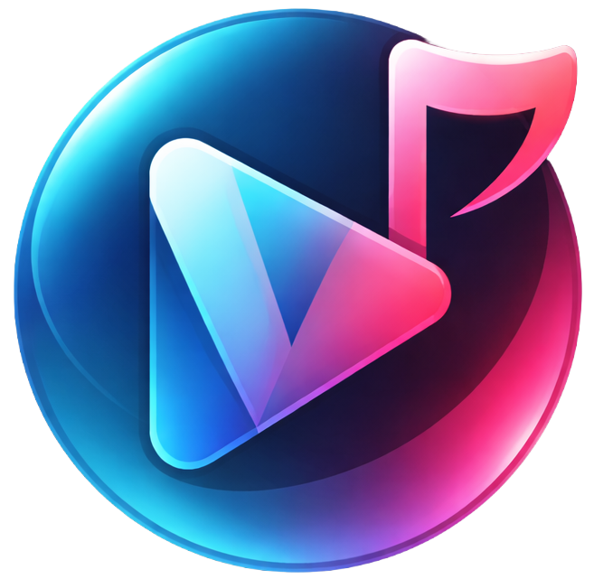
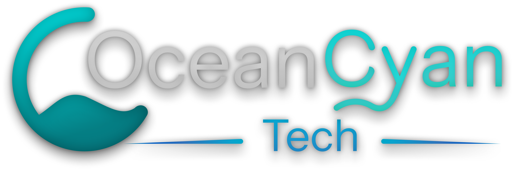

  
  <h1>Vusic Player</h1>
  
<strong>A modern, privacy-first media player &amp; audio DSP suite for Windows 10 &amp; 11.</strong>

  

    
  

  

    
    
    
  

  

    <a href="https://oceancyantech.github.io/Vusic-Player/">Website</a> &bull;
    <a href="https://oceancyantech.github.io/Vusic-Player/howtousevusicplayer.html">User Guide</a> &bull;
    <a href="https://oceancyantech.github.io/Vusic-Player/validtimestamps.html">Timestamp Formats</a> &bull;
    <a href="https://oceancyantech.github.io/Vusic-Player/about.html">About</a> &bull;
    <a href="https://oceancyantech.github.io/Vusic-Player/donate.html">Donate</a> &bull;
    <a href="https://oceancyantech.github.io/Vusic-Player/feedback.html">Send Feedback</a>
  

---

## 📸 Screenshots

---

## ⚡ Core Features

### 🎬 Universal Playback Engine
- **No External Codecs Required:** Play MP4, MKV, AVI, MOV, FLV, MP3, FLAC, WAV, OGG, and dozens of other container formats and codecs out of the box.
- **DirectX Hardware Acceleration:** Smooth, low-latency video decoding and presentation powered by Flyleaf and DirectX.
- **Real-Time Video Adjustments:** Fine-tune brightness, contrast, hue, saturation, and orientation on the fly during playback.
- **Smart Playback Memory:** Automatically remembers playback progress for videos and tracks recent media history.

### 🎧 Advanced Audio & DSP Routing
- **Simultaneous Multi-Device Output:** Route audio to multiple playback devices (e.g., wired headphones, Bluetooth earbuds, external speakers) at the same time with independent per-device volume controls.
- **Live & Batch Digital Reverb:** Apply studio reverb presets (`Cathedral`, `Hall`, and custom room parameters) directly in memory during playback or batch-export entire folders in parallel.
- **Real-Time & Batch Pitch Control:** Adjust playback pitch smoothly on the fly for both audio and video, or batch-shift audio tracks by ratio, semitones, or octaves.

### ✍️ Subtitle & Lyric Suite
- **Online Lyric Fetcher:** Automatically search and retrieve synchronized lyrics from the web via LRCLIB.
- **Built-in Lyric Editor & Live Preview:** Create, edit, and fine-tune timestamped lyrics with an interactive live display during playback.
- **Integrated Subtitle Editor:** Extract embedded video subtitle tracks or create, adjust timing, and edit subtitles directly inside the application.

### 🗂️ Media Management & Tagging
- **Unified Music & Video Library:** Automatically scans, indexes, and organizes your local media with rapid SQLite-backed search.
- **Batch Tag & Cover Art Editor:** Inspect and update metadata (Title, Artist, Album, Genre, Year) and embed cover art across multiple audio/video files simultaneously.
- **Online Artwork Search:** Search and retrieve high-resolution artist images and album covers directly within the app.
- **Playlists & Queues:** Drag-and-drop queue management, custom playlists, and full-folder playback.

### 🎨 Customization & Privacy
- **Handcrafted Visual Themes:** Choose between distinct color palettes and bespoke iconography tailored for modern Windows design.
- **100% Free & Open Source:** Licensed under GNU General Public License v3.0 (GPLv3).
- **Privacy-First:** Fully local processing with zero background telemetry, ads, or tracking.

---

## 🛠️ Built With

- **Framework:** [Windows App SDK](https://github.com/microsoft/WindowsAppSDK) (WinUI 3) & [.NET 8](https://dotnet.microsoft.com/)
- **Media Core:** [FlyleafLib](https://github.com/SuRGeoNix/Flyleaf) & [FFmpeg](https://ffmpeg.org/)
- **Audio Routing & DSP:** XAudio2, [Vortice.Windows](https://github.com/amerkoleci/Vortice.Windows), & SoX Reverb
- **Metadata & Tagging:** [TagLib#](https://github.com/mono/taglib-sharp)
- **Local Storage:** SQLite
- **MVVM Architecture:** [CommunityToolkit.Mvvm](https://github.com/CommunityToolkit/dotnet)

---

## 💖 Support & Feedback

- **Download:** Get the latest release on the [Microsoft Store](https://apps.microsoft.com/detail/9MST111CFJPD)
- **Issues & Suggestions:** Open a GitHub Issue or submit directly via the [Feedback Page](https://oceancyantech.github.io/Vusic-Player/feedback.html)
- **Support Development:** Vusic Player has zero paywalls. If you find it useful, you can support ongoing development via UPI or Ko-fi on the [Donate Page](https://oceancyantech.github.io/Vusic-Player/donate.html)

---

  
  

    Developed by <a href="https://oceancyantech.github.io/Vusic-Player/about.html">OceanCyan Tech</a> &bull; Licensed under <a href="LICENSE">GPLv3</a>
  

